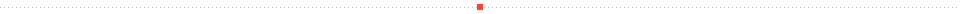
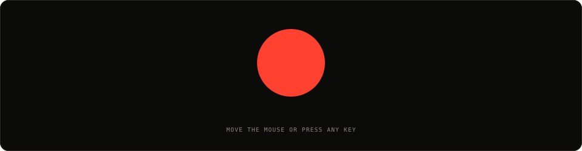

<p align="center">
  
</p>

<p align="center">
  <code>next.js 16</code>&nbsp;
  <code>typescript</code>&nbsp;
  <code>tailwind css 4</code>&nbsp;
  <code>gsap</code>&nbsp;
  <code>lenis</code>&nbsp;
  <code>canvas 2d</code>&nbsp;
  <code>view transitions</code>
</p>

Most portfolios are a page you scroll. **This one boots.**

It's the portfolio of **Aakash Buddha Kannan**, a third-year computer science
student in Chennai who builds full-stack, machine learning and
quantum-optimization products. **He's open to internships.**

The site is his own operating system, **NOIR/OS**. On the first visit a boot
log counts to 100 as the page really loads, then the screen opens onto a
desktop: a menu bar with a live Chennai clock, four numbered apps in the
corners, and his name across the middle in dot-matrix letters. Apps open as
windows and **ESC** closes them. His internship status, résumé, GitHub and
LinkedIn are all on that first screen.



## Five case files on a canvas you can drag

<p align="center">
  
</p>

`projects.vol` lays the projects out on a plane you can drag, scroll or move
with the arrow keys. Each case has its own generative artwork, drawn live in
glyphs on a canvas. They're abstract on purpose, so none of them pretends to be
a screenshot. Switch to the list for index, kind, year and stack.

| | What it is | Built with | |
|---|---|---|---|
| **CHENG** | Personal AI desktop assistant | Claude Agent SDK · React · MediaPipe · WebSockets | |
| **FarmSync** | Quantum-AI crop advisor | Flutter · FastAPI · LightGBM · PennyLane | [source](https://github.com/Aakashxnoir/FarmSync) |
| **RIT Digital Twin** | Smart campus management platform · *1st Place, Designathon 2025* | React · Spring Boot · MySQL · Docker | |
| **Sevagan** | Civic issue tracking platform | React · Express · Supabase · Solidity | [source](https://github.com/Aakashxnoir/Sevagan---Multilingual-Service-app) |
| **Infinitus** | Mathematics club platform | Next.js · Supabase · Resend | [live](https://infinitus-seven.vercel.app) · [source](https://github.com/Aakashxnoir/Infinitus) |


## A timeline that's a git log

<p align="center">
  
</p>

`timeline.log` is his path so far, shown as `git log --graph`: `main` for the
degree, then `build`, `wins` and `clubs`. Scrolling walks the graph sideways,
the lines draw up to the commit you're on, and `git show` prints it. The end of
the degree is dashed because it hasn't happened yet.


## Extras, for the curious

<p align="center">
  
</p>

**Extras → Terminal** answers real commands about him. **Extras → Lights Out**
is an F1 start: five red lights come on one by one, then go out, and you react.
Jump the start and you're penalised. (He won a Grand Prix F1 gaming tournament,
so the bar is set.)

| | |
|---|---|
| `whoami` · `projects` · `stack` · `wins` | the short version of him |
| `open <app\|project>` | open a window — `open cheng`, `open timeline` |
| `theme <noir\|amber\|green>` | switch the phosphor |
| `lights` · `sleep` | play Lights Out, or start the screensaver |
| `sudo` | try it |

The **System** menu does the same by hand: phosphor, the CRT effect, motion,
and Sleep. Leave the site alone for 90 seconds and it dozes off.


## Nothing waits on the animation

Every effect has a fallback. With reduced motion or without JavaScript, every
page is complete and still, and nothing ever blocks the menu bar, the résumé or
the email link.

| | With motion | Reduced motion or no JavaScript |
|---|---|---|
| Boot screen | powers on from a line, counts on real loading, opens from the middle | shown still, then fades (skipped without JavaScript) |
| Windows | grow out of the corner you clicked (view transitions) | ordinary page changes |
| Headings | scramble in from random glyphs | already there |
| Projects | a canvas you drag, artworks drawn live | one still frame; the list without JavaScript |
| Timeline | scroll walks the graph | a plain list |
| Menus | | `<details>`, and every item is a real link or button |


## Run it

You need **Node 20+**.

```bash
npm install
npm run dev     # http://localhost:3000
npm run build   # production build
npm run lint
```

<details>
<summary><b>Where things live</b></summary>
<br>

| Path | What |
|---|---|
| `src/content/` | all the copy: site, projects, profile, timeline, extras. Case-study roles, team sizes, links and media go in `projects.ts` |
| `src/components/shell/` | menu bar, menus, clock, path bar, ESC handling, window transitions |
| `src/components/ascii/` | the glyph engine and the project artworks (`fields.ts`) |
| `src/components/motion/` | boot screen, Lenis smooth scroll, heading scramble, reveals, scroll-lit text |
| `src/components/extras/` | terminal (`commands.ts`), Lights Out, screensaver |
| `src/components/{desktop,work,case,timeline,profile,contact}/` | one folder per app |
| `src/lib/prefs.ts` | phosphor, CRT and motion preferences, set on `<html>` before first paint |
| `docs/` | the PRD, the design system and the staged build plan |

</details>

<details>
<summary><b>Rebuilding these images</b></summary>
<br>

Every image on this page is built from the site itself: the copy from
`src/content`, the colours from `globals.css`, the project artworks from the
real field functions, and Doto set as outlines from the font file. Change the
site, then run:

```bash
node --experimental-strip-types scripts/readme/build.mjs
```

It needs ImageMagick (`magick`) for the portrait, and the flag only on Node 22.
With reduced motion on, each image is a still of its finished state.

</details>


<table>
<tr>
<td width="96"><a href="https://github.com/Aakashxnoir"></a></td>
<td><b>Aakash Buddha Kannan</b> · <a href="https://github.com/Aakashxnoir">@Aakashxnoir</a> · <a href="https://www.linkedin.com/in/aakashbuddhakannan">LinkedIn</a> · <a href="mailto:aakashb.kannan@gmail.com">aakashb.kannan@gmail.com</a><br>B.E. Computer Science, Rajalakshmi Institute of Technology, 2024 to 2028 · open to internships · Chennai, IST (UTC+5:30)</td>
</tr>
</table>

<p align="center">
  
</p>

**Credits.** Type is [Doto](https://fonts.google.com/specimen/Doto) and
[JetBrains Mono](https://www.jetbrains.com/lp/mono/), both under the SIL Open
Font License.
